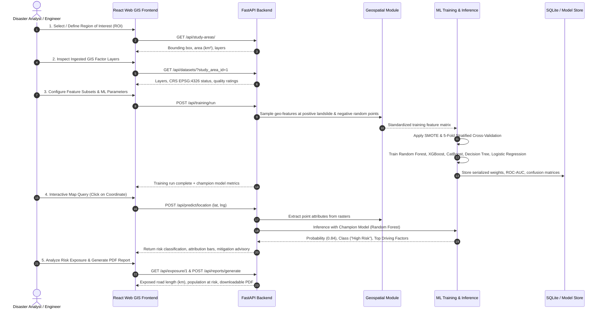

# LandSense AI — Project Workflow & Execution Pipeline

This document outlines the step-by-step technical execution flow of the LandSense AI platform.

---

## 1. High-Level Pipeline Sequence

---

## 2. Phase-by-Phase Breakdown

### Phase 1: Spatial Scope & Study Area Definition
1. User defines geodetic coordinates ($Lat_{min}, Lng_{min}, Lat_{max}, Lng_{max}$) or selects the pre-configured Himalayan demo sector (*Rishikesh-Devprayag Valley*).
2. The system checks bounding geometry and computes surface area in square kilometers ($km^2$).

### Phase 2: GIS Ingestion & Factor Harmonization
1. Topographic Digital Elevation Model (DEM) is reprojected to EPSG:4326.
2. Primary terrain attributes (Slope, Aspect, Curvature, TPI, TRI) are computed via moving window kernels.
3. Secondary hydrological attributes (TWI, SPI) are computed using cumulative drainage flow formulas.
4. Linear infrastructure (Roads, Rivers, Faults) are processed into continuous Euclidean proximity rasters.

### Phase 3: Spatial Sampling & Negative Sample Generation
1. Positive anchors ($Y=1$) are extracted from verified historical landslide scars.
2. Negative anchors ($Y=0$) are drawn randomly across the study area, excluding a 500m buffer zone surrounding known landslide scars.
3. Feature values from all conditioning rasters are extracted at the sample coordinates to assemble a tabular ML dataset.

### Phase 4: Supervised Training & Cross-Validation
1. Dataset is partitioned into 80% training and 20% held-out test splits.
2. SMOTE is applied on training folds to address sample imbalance.
3. 5-Fold Stratified Cross-Validation is executed across all 5 candidate algorithms.
4. Performance metrics (Accuracy, Precision, Recall, F1-Score, ROC-AUC mean $\pm$ std) are compiled.
5. The champion model (highest ROC-AUC) is designated as active for live inference.

### Phase 5: Spatial Inference & Explainability
1. User clicks any point on the Leaflet map.
2. The coordinate triggers feature extraction across all GIS rasters.
3. The Champion Model calculates the exact probability of landslide occurrence ($P \in [0.0, 1.0]$).
4. Probability is mapped to 5 susceptibility classes:
   - **Very Low:** $P < 0.20$
   - **Low:** $0.20 \le P < 0.40$
   - **Moderate:** $0.40 \le P < 0.60$
   - **High:** $0.60 \le P < 0.80$
   - **Very High:** $P \ge 0.80$
5. Feature attribution highlights the primary triggering mechanisms (e.g. over-steepened slope + proximity to road toe excavation).

### Phase 6: Exposure Quantification & Emergency Decision Support
1. Spatial intersection is performed between the high-hazard zone and infrastructure vector layers:
   - Highway kilometers at risk
   - Habitations and settlements endangered
2. The nearest lower-susceptibility safe refuge locator computes rapid evacuation routes toward stable ridges.
3. A formal engineering audit report is generated for administrative review.
